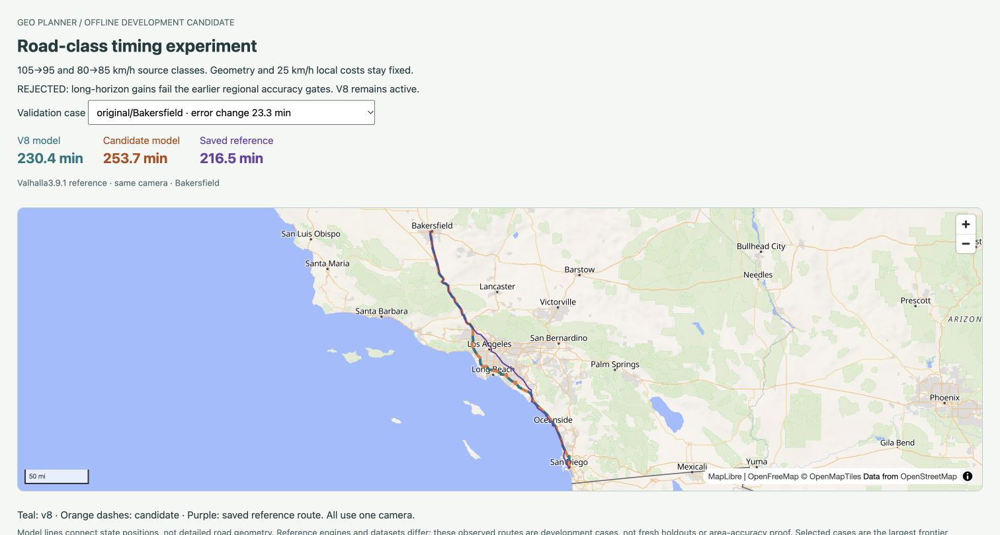

# Road-class timing calibration: rejected

October 23, 2026. Clean base commit **37ff14b** (`new`) includes the prior reference tools/results. Runtime v8/slider remains unchanged; the last independent hosted checks are the [prior public contract run](../coarse-frontier-tool-2026-10-23/README.md). New producer/comparator/preview/tests and this evidence/docs are local/uncommitted. Separate floating-map UI edits arrived concurrently and were left intact; current docs merge both task states. This accuracy task made no app graph/weight change, activation, commit, push or deployment.

**The proposed source-class change 105→95  / 80→85km/h fails its predeclared accuracy gates and is rejected.** It substantially improves the 48 long-horizon probes but worsens both retained regional sets. All83 cases remain finite, all 35 prior destinations remain shaded, and every baseline/candidate path sum reconstructs. We did not change the gates, select a replacement query or add a location exception. [Full ledger](comparison.json), [decision and per-origin means](decision.json), [unchanged admission plan](../coarse-frontier-reference-2026-10-23/calibration-plan.json).

## Exact source-based experiment

[New producer](../../../scripts/build-coarse-calibration.py) preserves every v8 geometry/state/visit/anchor/mask/shore/transfer field. It reconsiders all original Natural Earth and 49 pinned Census source partitions with unchanged eligibility, deduplication, continuous-land connector and source-arc rules. It first reproduces **every original base/layer road cost and base speed tag exactly**, then selects minima under the proposed class mapping. No sealed historical producer is edited or rerun as a health check; pure source/geometry helpers are imported. Candidate costs are recomputed from source-arc/connector components, not by scaling aggregate fixed 25km/h costs.

NE legacy connectors retain their road-class charging rule; Census connectors and explicit local/layer transfers remain at 25km/h. Source class order/ties remain 55<85<90<95, so frozen representative ownership/geometry is compatible with the mapping. All alternative candidate costs pass the 95km/h physical chord lower bound before selection. The producer emits new source proofs for 378,515 base and 346,821 Census-layer links. A separate independent full proof/peak-runtime/package qualification was not run after the necessary accuracy gates failed.

Candidate: `data/coarse-quality/class-timing-candidate-v1/grid.json`, **61,219,368 bytes**, SHA `212b1f7a1e26a17ba81c1194becf326f6fa95b649ebf88575a7361ca0aae287c`. Active v8 remains 61,208,381 bytes / SHA `2beb2fb6d9af6e07f37c5ba53acdeca2da1334c31a5fadd1371efd5453134910`. [Build record](build.json), [policy](policy.json). This intentional source pass takes 116.827s, max RSS 1,205,796,864 bytes on this Mac; that is producer RSS, not Vercel/runtime peak. All pinned sources/tools were already local; no download or new dependency.

## Accuracy gates

[New comparator](../../../scripts/compare-coarse-calibration.ts) verifies every frozen v8 point arrival and the 48 predeclared whole-cell classifications. It uses exact production searches/transitions/attachments, retains all 83 cases and reconstructs 83 paths for each model. Only one origin’s labels are retained at a time. A diagnostic 900-minute search horizon covers candidate point costs outside 720; public API/UI limits do not change. [Compressed path coordinates](paths.json.gz) connect model states; they are not full source polylines.

| Development set | Pairs | V8 mean absolute difference | Candidate | Improved/regressed |
| --- | ---: | ---: | ---: | ---: |
| Frontier probes | 48/48 | 52.273min | 35.097min | 32/16 |
| Original regional | 11/11 | 10.288min | 20.553min | 0/11 |
| Broader regional | 24/24 | 12.011min | 15.869min | 11/13 |

Frontier nearest-rank p90 improves 116.332→70.165min; cell counts become 31 correct /eight false reachable /six missed reachable /three ambiguous, versus 23/17/5/3. Both frontier gates pass. **Original and broader regional mean gates fail** (10.288→20.553 and 12.011→15.869min). The prototype cannot be activated under the frozen plan. Across all 83 cases, 43 improve/40 regress; do not substitute a favorable combined mean for the separate gates.

The largest frontier regression is `hays-ks-720-inside`: absolute error worsens **71.547min**, with model 710.379→781.925min versus reference 688.465min. The largest original-regional regression is `Bakersfield`: absolute error worsens 23.310min, model 230.418→253.728 versus reference 216.454min. The complete ledger retains all other regressions; these names identify validation evidence only.

## Shared-camera review

[Preview generator](../../../scripts/preview-coarse-calibration.ts) and [template](../../../scripts/coarse-calibration-preview.html) select the greatest frontier improvement, frontier regression and regional regression from the full ledger. Teal v8, dashed orange candidate and purple saved reference use one camera. Chrome verifies all three timing panels and the REJECTED label; no application console error was observed, aside from an unrelated extension error. [Browser scope](browser.json). Local preview-v1 is `http://127.0.0.1:4180/`; shorter-map preview-v2 is **http://127.0.0.1:4181/**. Rediscover listeners/owners instead of relying on old PIDs or tool sessions.

[Frontier improvement](frontier-improvement.png), [frontier regression](frontier-regression.png), [first regional viewport](regional-regression.png) are preserved. The [full-page capture](regional-regression-full.png) renders part of its WebGL map; it is retained as a capture artifact, not route evidence. The complete normal viewport above uses the adjusted preview-v2 after basemap settling; the earlier immediate [viewport](regional-regression-complete.png) is retained. This is a path review, not an area/contour accuracy measurement. MapLibre basemap traffic is separate from routing quota.

## Follow-up diagnosis

[Offline source-proof/path analysis](diagnosis.json) joins all 83 baseline paths to the original source-link proofs, checking every road-edge time against its proof. It separates source road/connector distance and within-edge connector time; no new search or service call. [Producer](diagnose.py). The first attempt assumed an explicit `kind` field in Census-layer proofs and stopped; the implicit Census-layer kind is now handled. [Original producer](diagnose-v1.py), [failure](diagnosis-v1-failure.txt) and empty output remain distinct; no source evidence was overwritten.

| Set | Mean reference distance | Mean model source+connector distance | Mean internal connector time |
| --- | ---: | ---: | ---: |
| frontier | 903.44km | 902.06km | 23.03min |
| original | 201.22km | 209.40km | 11.89min |
| regional | 151.42km | 144.97km | 6.45min |

These are different selected paths; the ratios/connector times do not causally isolate rasterization, speed or access error. Local/explicit-transfer distance inferred from paid 25km/h cost includes tiny transfer rounding. The original short-route model paths are longer on average; broader regional paths are shorter on average despite positive timing error. A universal speed change or simple distance multiplier is therefore unsupported by this diagnosis.

**Reference consistency is also unresolved:** all 48 frontier references use **ORS 9.10.0**, while the 35 earlier references use **Valhalla 3.9.1-7fd2228e5** with a different graph/profile/date. Engine, geography and trip length vary together. The existing 83 cases cannot tell how much of their timing contrast comes from those separate factors. This is a confound, not a claim that either engine is incorrect or explains the entire failure.

**Next:** the [six matched-route control plan](control-plan.json) freezes identical public OD pairs before new ORS outcomes, chosen by evenly spaced distance ranks 0/6/13/20/27/34 among all 35 regional cases. It will compare ORS/Valhalla on the same geography, retaining engine/date/snap/route differences and every failure. It has **not been acquired**, has no standing quota authorization and still needs a bounded capture/replay helper with synthetic tests before asking for the exact six-request  / zero-paid-spend budget. The old 48-request budget is consumed. Do not keep fitting class speeds or relax the rejected candidate’s gates.

## Verification and recovery

Biome (155 files), app/strict diagnostic typechecks and ordinary [build](app-build.txt) pass. [24 Python fixtures](python-tests.txt) include five new pricing/encoding-policy cases that verify fixed local charges, legacy class connectors, preserved class order and overflow rejection. Both models decode, every frozen baseline point/classification matches, all 83 baseline/candidate pairs remain finite, all 166 path sums reconstruct and all 35 older destinations stay shaded. Earlier server tests remain their named evidence; no unchanged server/DB suite or Vercel package rebuild was repeated. [Checks/source bindings](checks.json), [evidence hashes](sha256.json).

Failed candidate and source proofs stay in ignored `data/coarse-quality/class-timing-candidate-v1/`; full comparison/paths in `class-timing-evaluation-v1/`; previews in `class-timing-preview-v1/` and `-v2/`. Do not promote/commit the failed grid as the runtime model. [Exact commands and prerequisites](../../local-development.md#road-class-calibration-experiment). Preserve every failed/older artifact. No provider request, new key, database/schema/env/dependency change, hosted history write, detailed graph build, commit or deployment occurred. [Current next steps](../../next-steps.md).

Model source attribution: Natural Earth + U.S. Census Bureau 2026 TIGER/Line, modified/repackaged by Geo Planner, not an official Census product. ORS reference routes: © openrouteservice by HeiGIT | Data from OpenStreetMap, CC-BY-SA 4.0; older regional routes use retained Valhalla/OpenStreetMap. These now-observed sets are development evidence, not new independent or national accuracy qualification.
