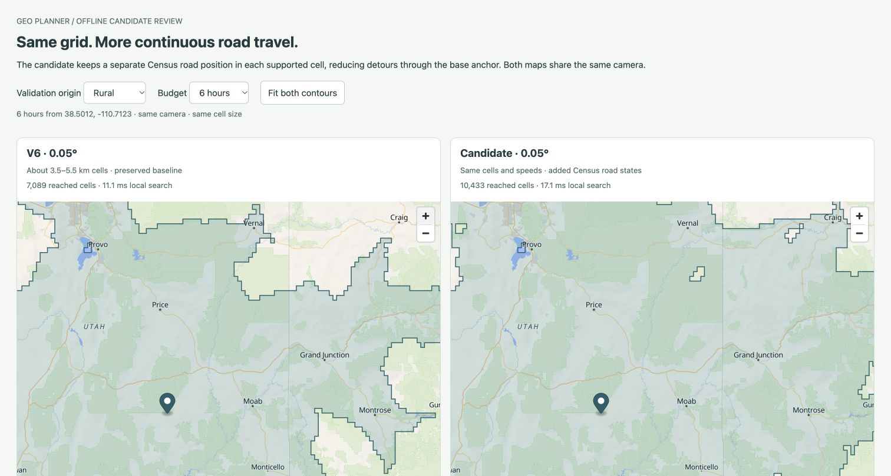

# V7: continuous Census road travel

October 23, 2026. **V7 is active locally and uncommitted.** Starting HEAD `ffd7fec` contains v6; the user reports it committed/verified live. This run does not deploy v7 or independently verify the hosted v6 revision. [Current handoff](../../agent-handoff.md), [next steps](../../next-steps.md), [recovery commands](../../local-development.md#census-road-states-v7).

## Problem and generic correction

V6 forced Census links through the base/NE anchor at both cell ends, even when consecutive links followed a different Census road. The saved paths and synthetic fixture expose repeated local detours. V7 retains the original graph/options and adds a second road position per cell, using the **existing supplemental Census visit anchor**. All national source arcs are reconsidered, not just old winning base links. No city, coordinate, state or region is a routing exception; validation locations enter only offline comparisons.

There are **135,128 Census states and 159,189 new links**. Source arcs preserve bends and a physical chord floor, at unchanged S1100=105 / S1200=80 km/h assumptions. Both connectors to the selected Census anchors pay continuous-land distance at 25 km/h. Base↔Census transfers pay their checked physical distance at 25 km/h, rounded upward to at least 0.1 second; zero encodes an absent state. Census states have explicit source-road edges and paid base transfers, with no implicit overland edges. Input access can seed either layer, alongside every old v6 attachment. Contours use the minimum arrival across a cell’s states. Shared production `gridTransitions` also reconstructs diagnostic paths.

This avoids mandatory return to the unrelated base anchor while retaining physical charges. It remains one selected Census representative per cell: unrelated roads/crossings merge, local connector detours and source gaps remain, and NE legacy connectors retain class-speed assumptions. Terrain, traffic, turns, one-way/access, ferries and international eligibility are unmodeled. Generalized land and assumed overland travel are still substantial limitations. **Same 0.05° cells (3.5–5.5 km); no precision increase or national accuracy claim.**

## Reproducible artifacts

- [Source build](build.json): candidate **79,584,632 bytes**, SHA `d2f220d90d3d27caaf6d19aab63e2fb0365ea3f29a06398be3ff365b921c3c73`, ignored `data/coarse-quality/road-layer-v1/grid.json`.
- [Independent repeat](repeat-build.json): full second national source pass reproduces candidate and compressed proofs byte for byte. The source pass takes about 70.1 seconds locally; this is offline build time, not query latency.
- [Finalization](finalization.json), [repeat](finalization-repeat.json): active [coarse-grid-v7.json](../../../src/server/data/coarse-grid-v7.json), **79,584,626 bytes**, SHA `988d1ef988e0ca587b60cb3ee4d688eed37629bdb62f344d7f49e8f6f6349379`. Only version changes; every other candidate field matches. Active/repeat outputs match exactly.
- Every v6 base field except version remains identical, including its 613,600 cells, 168,149 base links, visits, source locks, masks, shores and notices. Preserved [v6 artifact/evidence](../coarse-resolution-2026-10-23/README.md) and v1–v5 hashes remain unchanged. `roadLayer`, base hash and connection-model explanation are additive.

The 49 Census source locks/catalog, 289.2 MB ZIP inputs, NE caches and pinned PyShp reader are reused offline. No source download or old producer execution occurred. Full compressed new-link proof remains ignored at `data/coarse-quality/road-layer-v1/links.json.gz`, **10,226,099 bytes**, SHA `fc71016fd7fbbcba10bc0a512499133c0d199027a1cb5d4dd6e02873111049f5`. Repeat matches. [Source hashes](sources.json) observe this implementation; runtime/tool changes remain allowed in later versioned runs.

## All saved trips

[Comparison](comparison.json) recomputes all 35 v6 costs and asserts exact agreement with sealed v6 measurements before evaluating the candidate. Every sample is finite/reached/shaded; none is excluded.

| Development set | Cases | Mean absolute reference difference, v6 → v7 | Improved / unchanged / worse |
| --- | ---: | ---: | ---: |
| Original | 11 | 14.712 → 11.579 min | 4 / 7 / 0 |
| Broader regional | 24 | 23.615 → 17.211 min | 17 / 7 / 0 |

Largest absolute-error reductions include both Salton City/Bombay Beach directions (~26.23 min), Bombay Beach→Indio (~22.09 min) and Bakersfield→Big Bear (~19.80 min). Large remaining errors stay visible. All [35 paths](paths.json) reconstruct through production transitions with checked sums; new Census-road and layer-transfer components are explicit. Path/attachment IDs at or above 613,600 denote Census state `613,600 + physicalCell`, not a different geographic cell.

These are reused Southern California/static development references, not fresh holdouts, national driving accuracy or 6–12h contour-frontier validation. Adding physically charged options cannot increase minimum model costs, but it can worsen real-world error where existing estimates are too fast. The observed zero regressions apply only to these saved cases, whose v6 estimates were above the references. Expanded contours elsewhere are software behavior, not accuracy evidence.

## Geometry, storage and runtime

[Verification](verification.json) checks all 159,189 new road links against hash-bound source components, every one of 135,128 base/layer transfers, full visit/anchor validation and unchanged v6 fields. New connectors/transfers require continuous land; explicit source-road arcs may cross water. [42 candidate cases](national-candidate.json) / [42 active API cases](national-api.json) pass increasing-budget counts, no fewer v6 cells, payload bounds and sampled full-path maximum-speed lower bounds. Counts do not establish accessible land or actual road coverage. New candidate max search observation is 146.4 ms in that verification run; other previews and concurrent jobs have their own local timing observations. The raw `summedConnectorShare` is an unweighted statistic over the new layer's edge population, not typical trip delay or a controlled old/new error decomposition.

[Memory sweeps](memory.json): **65,924,365 bytes** incremental retained decoded heap+buffers, with parsed encoded input retained separately. Three complete supplemental-anchor sweeps total **405,384 inputs**; post-GC heap growth 114,776 / 116,080 / 116,088 bytes, buffers zero. No growing decoded/query cache. Load still validates every visit. Temporary allocations, encoded input, whole-process lifetime RSS, cloud peak memory and capacity are separate scopes.

After other offline jobs finished, three fresh isolated candidate handlers compute their first estimate after config in **3,124.7 / 3,204.1 / 3,207.9 ms** ([1](handler-1.json), [2](handler-2.json), [3](handler-3.json)), meeting the <5s local engineering target. [Final active v7 handler](v7-handler.json): **83,398,601 bytes / 28 files**, first **3,093.1 ms**, then **97.7 / 80.3 ms** in that process. Zero outbound calls; enabled coarse API, disabled detailed research, server-only dataset/secrets, no raw/env files and DB-free history fallback pass. These exclude earlier module/config loading and are not cloud cold/warm, concurrency or load measurements.

## Visible review and release checks

[Local paired page](http://127.0.0.1:4177/preview/) has twelve inland/rural/coastal/mountain scenarios at 6/10/12h, matching camera, same cell size/speeds, visible model/source cautions and synchronized zoom. [Browser review](browser-comparison.json) records each selector/count. Rural six-hour reached cells change 7,089→10,433; mountain 9,886→13,387. Larger contours do not by themselves demonstrate more accurate travel times. Initial full-page WebGL captures show partial canvases and are preserved in the ignored evaluation directory; the final screenshot is a normal viewport capture.

[Main-app review](browser-main.json) covers public inland 6h, rural 10h, coastal 12h, visible v7/source/0.05° notices, map controls and a new coastal fixture Cloud saved→reload→Replay. Only fixture history is inspected; no private cookies or bulk history export. Persistence/env/schema are unchanged; the full live DB integration suite is not repeated.

[Checks](checks.json): **55 server tests**, nineteen Python geometry fixtures, [Biome](check.txt) (146 files), [app typecheck](typecheck.txt), [diagnostic typecheck](diagnostic-typecheck.txt), [ordinary build](build.txt), [Vercel build](build-vercel.txt), generated handler and all new physical/source/repeat checks pass. New synthetic fixtures cover continuous paid road travel, both-layer contour arrivals, preserved v6 options, absent implicit road-layer land edges, malformed/shifted/dangling/undercharged data and water rejection. [Test log](tests.txt), [Python fixtures](geometry-tests.txt).

No new env variable, dependency, DB migration, reference/provider request, detailed build, commit/push or deployment occurred. V7 remains local/uncommitted; include its bundled artifact in publication. Next: verify actual v7 after publication, then measure a finer 0.025° candidate and its storage/runtime tradeoffs while keeping the app deployable. No 0.025° candidate exists. [Checksums](sha256.json) seal this run; preserve all original/failed evidence.
