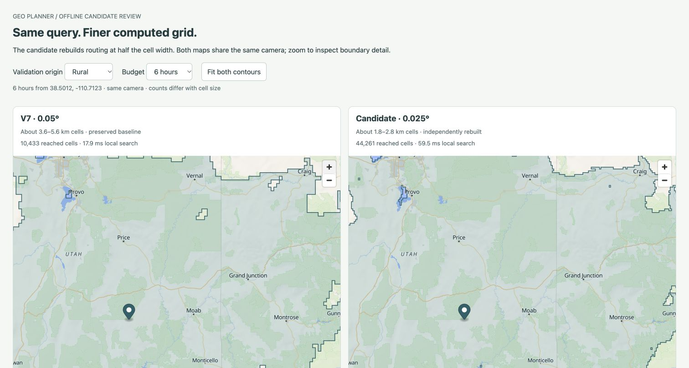

# V8: finer nationwide contours with deployable storage

October 23, 2026. **V8 is active locally at 0.025° (about 1.8–2.8 km cells).** V7/v8 changes remain uncommitted; HEAD `ffd7fec` contains v6, user-reported verified live. This run does not publish/deploy v8. [Handoff](../../agent-handoff.md), [recovery](../../local-development.md#finer-resolution-v8), [next steps](../../next-steps.md).

## Rebuilt geometry and preserved rules

The configurable resolution builder independently rebuilds **2,360×1,040 = 2,454,400 cells** from the existing pinned national inputs. It recomputes masks, canonical anchors, source visits, roads, mixed-shore representatives and connections; it does not upsample old labels or smooth the display. V7's generic Census road-state rule is carried into the finer graph through an explicit hash-qualified base input. Named places appear only in validation. Source classes/speeds, physical charges, country/lake/land checks and 1 km input-only shore tolerance remain unchanged.

There are **378,515 base links, 123,116 NE owner visits, 317,586 Census visits/states / 10,762,067 points, 346,821 Census-layer links, 10,936 mixed-shore representatives and 36,325 shore links**. Census road arcs preserve source bends/chord bounds and pay continuous-land connectors at 25 km/h; switching to the base state pays physical distance, rounded up to at least 0.1 second. Census states have no implicit overland neighbors. NE legacy connectors retain class-speed assumptions. These remain coarse merged road positions, not routable topology: traffic, turns, one-way/access, terrain, ferries and border eligibility are unmodeled. Source gaps, generalized coasts and assumed overland travel remain. **Cell size is not an accuracy bound.**

## Reproducible and smaller deployment artifact

| Stage | Bytes | SHA-256 |
| --- | ---: | --- |
| Base grid | 134,107,947 | `01ab7afcbf69a7a074984864ba4aacf3395bbd3225b472d4099f20b42f223e56` |
| With Census road states | 179,924,201 | `3dfdb35c180be2e998c65ea57d56c686117bda1431891093b24cc1819d4576f6` |
| Losslessly packed candidate | 61,208,393 | `f5dd46f223fc4a6d601235adc4c59cb8a31326aa416c6fe0da522e34a14dbb5a` |
| Active v8 | 61,208,381 | `2beb2fb6d9af6e07f37c5ba53acdeca2da1334c31a5fadd1371efd5453134910` |

[Preflight](preflight.json) finds that dense base64 arrays alone would exceed 111 MB at this resolution. [GitHub's source-file limit](https://docs.github.com/en/repositories/working-with-files/managing-files/adding-a-file-to-a-repository) makes the uncompressed single-file approach unsuitable. [Packing](packing.json) compresses existing binary arrays independently with gzip/base64 only when smaller, checking every inflate byte for byte. All metadata/graph rules remain unchanged; built-in Node zlib adds no dependency/service/env setting. The decoder accepts both legacy base64 and `gzip:` fields, bounds inflation per field and retains full structural/source validation. Signed/aligned little-endian word buffers can be reused directly; a fallback preserves word decoding on other layouts.

[Base build](base-build.json) / [independent repeat](base-repeat-build.json), [road-state build](road-build.json) / [repeat](road-repeat-build.json), [packing repeat](packing-repeat.json) and [version finalization](finalization.json) / [repeat](finalization-repeat.json) reproduce exactly. Active finalization changes only version. Source runs use all 49 cached Census partitions and pinned NE inputs/PyShp, with no downloads. Base build is ~142s / 2.57 GB native peak RSS on this Mac; that is offline producer scope, not runtime memory.

Full raw outputs/proofs remain ignored under `data/coarse-quality/resolution-0025-base-v1/`, `resolution-0025-road-v1/` and their `-repeat/` directories. Base compressed proof: **23,696,295 bytes / SHA `153e6a6d925ea35efb9ae7828c00139e75f957967f6af100aa11d5c41448567f`**. Road-layer proof: **21,855,061 bytes / SHA `93227cb018c52fcf9c425c5d823be5bae265fb4774d7f5c3e14a183087bff464`**. All v1–v7 artifacts and prior evidence hashes are unchanged. [Source observations](sources.json) do not freeze ordinary runtime/tool code; original sealed helper producers remain preserved.

## Every saved comparison, including six regressions

[Comparison](comparison.json) recomputes all 35 v7 point costs and asserts exact agreement with sealed v7 results, then evaluates the same geographic inputs against the finer model. Every sample is finite/reached/shaded; none is omitted.

| Reused development set | Cases | Mean absolute reference difference, v7 → v8 | Improve / regress |
| --- | ---: | ---: | ---: |
| Original | 11 | 11.579 → 10.288 min | 8 / 3 |
| Broader regional | 24 | 17.211 → 12.011 min | 21 / 3 |

All **29 improvements / six regressions** are retained. Worst regression is **+3.180 min**, San Diego→Borrego Springs; the remaining regressions are both Julian/Borrego directions (~+2.535), both San Diego/Santa Barbara directions (~+1.678), and Calexico (+0.560). [All regression/component changes](regressions.json), [all reconstructed paths](paths.json). Component changes describe different model paths, not isolated causes of real-world error; Census road time is a subset of total road time.

These are reused Southern California/static development references, not national accuracy, independent holdouts or 6–12h frontier validation. Smaller steps and larger counts are not accuracy measures. A nonregional long-horizon reference plan is next; no new reference/provider request was made.

## Full checks and bounded storage

[Base verification](base-verification.json) checks every retained source road / shore link; [layer verification](physical-national.json) checks every new road link / state transfer, full visit/anchor/land validation and physical/cost lower bounds. [42 candidate](national-candidate.json) / [42 active API cases](national-api.json) pass budget monotonicity, connected-origin/payload checks and sampled whole-path maximum-speed bounds. Cross-resolution cell counts are not compared as accuracy scores.

[Final memory sweeps](memory.json): **158,044,242 bytes** incremental retained decoded heap+buffers, with parsed encoded input retained separately. Three whole supplemental-anchor sweeps total **952,758 inputs**; post-GC heap growth 97,272 / 98,600 / 98,896 bytes, buffers zero. No growing decoded-visit/query cache. Encoded storage, temporary allocations, whole-process lifetime RSS, cloud peak memory and capacity remain separate scopes.

The fixed finer geometry index increases load heap: **3,862,960 bytes** in the final run. [Guard change/failure](memory-guard-change.json) explicitly records the old 2 MiB load-heap failure and the final **4 MiB** allowance for fixed index/views; query-growth guards stay 2 MiB heap / 64 KiB buffers. An intermediate test expected the former error wording; [its failure](intermediate-test-failure.txt) is preserved, and the final length-rejection assertion checks the new shared decoder error. No artifact/checksum or failed run was rewritten to hide a failure.

## Startup and Vercel package

The [initial profiled handler](handler-initial-profiled.json) takes 7.63s during concurrent offline work. Profiling highlights geography validation and dense loading. A narrower fixed latitude index alone remains marginal: three fresh [0.025°-index runs](handler-indexed-1.json) take ~5.85–5.93s; compact 0.01° bands/native words [still include a 5.06s miss](handler-compact-index-3.json). A narrower 0.005° experiment [also misses](handler-final-3.json), so the final index uses **0.01°** bands, compact views and a retained flat ring list. Direct indexed loading avoids dense per-entry allocations. Exact containment/intersection arithmetic, full checks and all 35 comparisons / 42 counts remain unchanged.

After other offline jobs finish, three fresh qualified candidate processes compute their first estimate after config in **3,592.4 / 3,597.6 / 3,657.7 ms** ([1](handler-direct-arrays-1.json), [2](handler-direct-arrays-2.json), [3](handler-direct-arrays-3.json)), meeting the <5s engineering target. [Final active v8 handler](v8-handler.json): **65,022,874 bytes / 28 files**, first **3,621.4 ms**, later **382.7 / 304.6 ms** in that process. Zero outbound calls, server-only data/secrets, no raw/env files, enabled coarse API, disabled detailed routing and no-DB fallback pass. The package passes the existing 250 MB local guard; no large-function opt-in is enabled. These exclude earlier module/config load and do not prove cloud cold starts, concurrency or capacity.

## Visible product and release state

[Local paired page](http://127.0.0.1:4178/preview/) / [browser checks](browser-comparison.json) cover twelve inland/rural/coastal/mountain scenarios at 6/10/12h, shared camera and synchronized zoom. Precomputed preview timings precede the optimization; geometry/counts are unchanged. Coast/rural steps are visibly smaller. Raw cell counts differ with resolution.

[Coastal detail](coastal-detail.png), [main-app screenshot](main-v8.png), [main-app checks](browser-main.json). Public 6/10/12h fixtures show v8 and 0.025° / 1.8–2.8km notices; a new fixture cloud save→reload→Replay and map controls pass. Only fixture history is inspected, no private cookie/bulk export. Persistence/schema/env are unchanged; the full DB write suite is not repeated.

[Checks](checks.json): **56 server tests**, nineteen Python fixtures, [Biome](check.txt) (148 files), [app](typecheck.txt) / [diagnostic typechecks](diagnostic-typecheck.txt), [ordinary](build.txt) / [Vercel builds](build-vercel.txt), source/physical/repeat checks and local handler pass. Compression parity/corruption, signed offsets, invalid transfer/anchor/link data, geography band/vertex/hole/open-ring parity and 0.025° masks are covered.

V8 remains local/uncommitted, alongside v7 changes. Include both new artifacts when publishing latest v8. No new dependency/env/migration, source download, driving reference/provider quota, detailed producer, agent commit/push or deployment. Next: actual v8 publication/verification and an independent national/long-horizon validation plan. [Checksums](sha256.json), [current next steps](../../next-steps.md).
