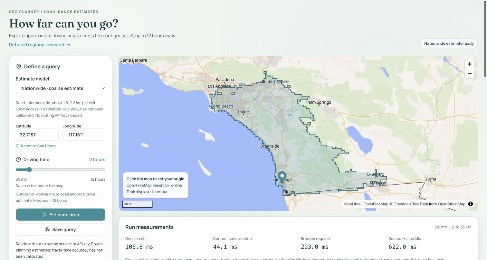

# Bounded frontier-reference tool and hosted slider checks

October 23, 2026. Base commit `9b3e83b` (`slider`), clean at the start of this work. The user reports that commit deployed; the production API does not expose a Git revision, so the SHA is not independently verified from Vercel. The new capture/replay tool and this evidence/docs follow-up are local/uncommitted. No agent commit, push or deployment.

## Hosted observations

[Production](https://geo-planner-orcin.vercel.app) now passes the [documented verifier](../../../scripts/verify-coarse-deployment.ts): [fifteen requests](deployment-after-ready.json), v8/min30/max720, five public origins at 6/10/12h with saved cell counts, a repeat, two overlapping requests, invalid inputs, disabled research and fresh no-cookie configured/empty history. Eight compute HTTP round trips are 345.2–1,449.8ms, including network/JSON delivery. These are not proven cold/warm invocations, search-only measurements, peak memory or load capacity.

The first sandbox attempt failed DNS before a response. The first network-enabled verifier then stopped after its configuration GET because minMinutes was 60. [Failure record](deployment-check-failure.txt); `deployment.json` is its empty output, not a passing report. The [subsequent configuration](production-config.json) reports 30 and the full verifier above passes. Preserve both observations; no explanation of the transient mismatch is established.

Chrome checks the public San Diego fixture with default 120/min30/max720, Home→30 automatic computation, pointer click/release→375 with visible `Updating area…`, rapid End/ArrowLeft→719 authoritative final result, reload→120 and keyboard automatic computation back to120. No Estimate area click was needed. The final 120 result reports 3,222 estimated cells, grid search 106.8ms, contours 44.1ms, browser request 293.0ms and source→map idle 622.0ms; scopes differ. [Screenshot](hosted-slider.png), [structured scope](browser.json). Physical drag-outside/touch cancellation, a separate max720 completed browser result and different-origin 6/10/12h browser flows were not repeated here; the scripted hosted cases cover those horizons. Earlier local UX evidence retains its original scope.

Automatic approval review rejected the attempted Save query action because it would create persistent hosted history and read-only/in-memory fixtures suffice. The action was not retried through another interface. No hosted history write/save-reload-replay was performed; persistence is unchanged and the full DB integration suite was not rerun. No existing history was deliberately queried/exported. The new tab's automatic initial accessibility snapshot included existing public fixture rows; subsequent inspections were scoped to controls/run measurements only, and the screenshot excludes history.

## Tool and offline verification

[Core](../../../scripts/coarse-holdout.ts), [CLI](../../../scripts/compare-coarse-holdout.ts), [tests](../../../scripts/coarse-holdout.test.ts). [Frozen plan](../coarse-holdout-plan-2026-10-23/plan.json), SHA `77360fec0906c5a3eeedc533eef55cbe8557659266c25badcc4b924412e4271e`, unchanged. Validation fixtures never enter application routing.

The CLI provides offline `--check`/`--replay` and explicit capture mode with `--confirm-48-requests`. Only capture reads existing server-only ORS_API_KEY configuration. It fixes the new HeiGIT endpoint and exact 48 bodies; at most 48 POST requests, >=6.5s between starts, 45s deadline covering headers/body, no retries/redirects/fallback/auth probe/paid upgrade. It stops on 401/403/429, zero returned remaining quota, a 2MB response limit or file-write error. It refuses directory reuse and has no resume mode. Interrupted attempts retain partial files and cannot silently spend a second budget.

Capture writes intent before fetch, bounded raw response text with known key echoes redacted, selected nonsecret headers, UTC timestamps, HTTP-plus-body elapsed time and fixed safe errors. Partial response text is retained on body timeout. HTTP failure/invalid route results remain visible. A final ledger covers all 48 cases, including skipped cases after a stop, and all capture files are checksum-bound. Disk errors stop further calls. Offline replay verifies the pinned plan, exact request bindings, contiguous attempt ledger, interval/timestamps, body bytes and checksums; it rejects altered/incomplete/unsealed records and never reads a key or calls the network.

Replay reports the frozen v8 point/reference signed and absolute differences, mean signed and mean/median/nearest-rank-p90 absolute differences overall/by horizon/by origin, cell classification with the five-minute ambiguity band, every unpaired case and >100m endpoint-snap flags. The primary results retain flagged snaps; a separate <=100m subset is explicit. These are model-conditioned frontier point probes, not a random national sample or area-accuracy estimate. No generic correction has been selected.

Eleven synthetic tests prove the full 48-request cap, exact bodies, interval/deadline, no retries, key/header/error redaction, status/quota stops, deterministic replay/classification, invalid/failed/skipped denominators, stalled fetch/body handling, partial/oversized responses, disk-failure stop, checksum rejection and CLI argument guard. Together with 56 unchanged server tests, **67 pass**. [Test output](tests.txt), [checks/source bindings](checks.json). Biome (152 files), app/strict diagnostic typechecks and ordinary [build](build.txt) pass. Initial test-only TypeScript context typing was corrected; the final strict check passes. No app/runtime code changed, so the Vercel build was not repeated. Earlier local packaging proof remains valid for unchanged runtime sources.

A retained **synthetic-only** capture at ignored `data/coarse-quality/coarse-frontier-tool-fixture-v1/` has one artificial route, one artificial 429 and 46 skipped rows. The actual CLI replay produces [synthetic-replay.json](synthetic-replay.json); those values are software fixtures, not reference travel measurements. Test scratch captures contain synthetic responses only and clean up after themselves.

## Next action and scope

**No real API key read, provider/reference request or routing quota use occurred.** Explicit authorization for up to 48 Directions POST requests and zero paid spending remains pending. Review the [exact public requests and provider conditions](../coarse-holdout-plan-2026-10-23/README.md), then use the [current commands](../../local-development.md#fixed-nonregional-frontier-plan). Capture only once into a fresh directory; retain failures and never replace/retry a case without a separately authorized budget. Provider attribution/license belongs with any future real reference data; the NE/Census runtime artifact remains separate.

Code inspection confirms `src/server/reachability.server.ts` and its endpoint mock test already use `https://api.heigit.org/openrouteservice/v2`. The previous current-doc migration todo was stale; no adapter change or live connected-provider request was made. The frozen planning report is preserved as written, with this later correction distinct.

All graph/model bytes and weights, dependencies/lockfile, environment files, DB schema/migrations and detailed research assets are unchanged. No source download, graph producer, memory sweep or full DB integration ran. This work prepares accuracy measurement; it does not establish improved driving accuracy.
