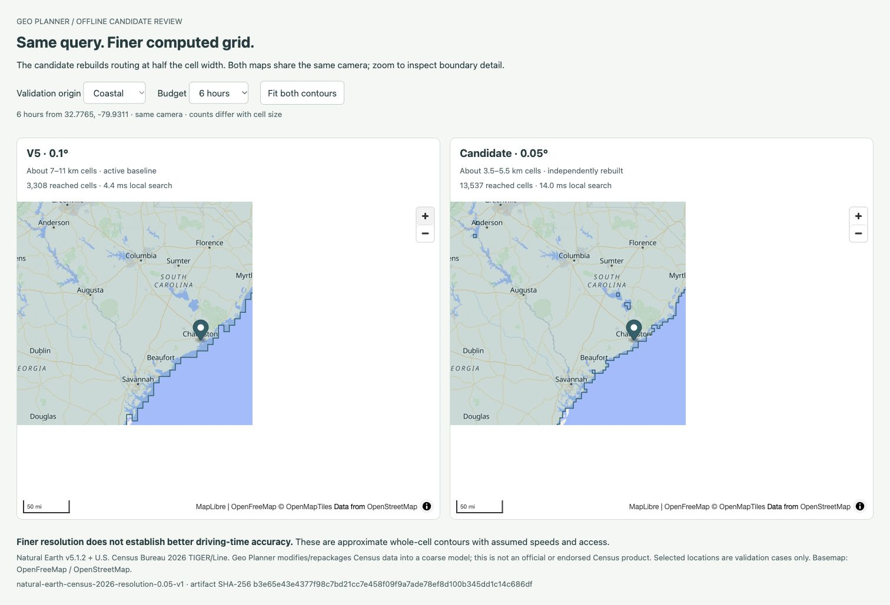

# Finer nationwide grid / v6 — October 23, 2026

**V6 is active locally at 0.05° (about 3.5–5.5 km cells), with lower error overall on the saved development references.** Production is user-reported v5; no commit/push/deployment occurred. This follows feedback that v5's unchanged 0.1° cells showed little obvious improvement. No city, coordinate or query-region exceptions were introduced.

## Rebuilt model and reproducibility

`scripts/build-coarse-resolution.py` rebuilds center land masks, quantized anchors, Natural Earth roads/owner visits, mixed-shore representatives, checked shore/access links and nationwide Census augmentation at a configurable step. It imports pure checked helpers from preserved producers without mutating or rerunning their entry points. The 49 pinned Census partitions, Natural Earth countries/lakes/roads and diagnostic-only PyShp wheel were reused offline; no acquisition, installed dependency, routing service or reference request was needed.

At 0.05°, dimensions are **1,180 × 520 = 613,600 cells**, four times v5's count. [Build](build.json) records **168,149 road links**, 58,773 NE owner visits, 135,128 supplemental Census visits / 8,678,176 points, 4,455 mixed-shore representatives and 13,597 shore links. Raw center masks use the pinned source polygons; runtime origin/transfer checks retain generalized boundaries, whose lake selection is recomputed at this resolution. These are newly computed labels/geometry, not upsampled v5 results.

Candidate/repeat: `data/coarse-quality/resolution-005-v2/grid.json` and the earlier `resolution-005-v1/grid.json`, **68,129,988 bytes**, SHA-256 `b3e65e43e4377f98c7bd21cc7e458f09f9a7ade78ef8d100b345dd1c14c686df`. The [first attempt](first-build-report-failure.txt) completed grid/proof files but exited on a relative output-path reporting bug. Its files are preserved; the corrected independent source pass reproduces both grid and compressed proofs exactly. [Build log](build.log). The successful producer takes 114.1 seconds; whole-process native macOS peak RSS is 2,104,262,656 bytes. This offline producer measurement is separate from runtime/Vercel memory.

Active `src/server/data/coarse-grid-v6.json` is **68,129,975 bytes**, SHA-256 `a1ba5ae3eb7419feb458641f00da1886802fc16ec11af86e3d61d42a3b8b3f99`. [Finalization](finalization.json), [repeat](repeat-finalization.json) and independent [parity](parity.json) change only `version` to `natural-earth-census-2026-grid-v6`. Every graph/geometry/source/notice field matches the candidate. Previous v1–v5 and failed/source evidence remain untouched. Git/Vercel include and Biome exclusion rules cover the new file; it must accompany publication.

## Travel-time results and regressions

[Cross-resolution comparison](comparison.json) uses the same geographic origin/destination inputs, recomputes each grid's attachments and checks all 35 v5 baseline costs against preserved evidence. Every case is finite/reached/shaded; none is dropped.

| Development set | Cases | Mean absolute reference difference, v5 → v6 | Improved / worse |
| --- | ---: | ---: | ---: |
| Original | 11 | 21.944 → 14.712 min (33.0% lower) | 9 / 2 |
| Broader regional | 24 | 31.204 → 23.615 min (24.3% lower) | 17 / 7 |

All **26 improvements and nine regressions** are retained. Worst absolute-error regression is **+7.092 minutes** (Bombay Beach → Indio), whose error remains about 60.3 minutes. Other notable increases are Borrego Springs +5.668 min and both Salton City/Bombay Beach directions +3.887 min. The [nine-case decomposition](regressions.json) and all [reconstructed paths](path-diagnostics.json) expose endpoint, road and local-travel changes; every path sum checks. Several regressions add intercell overland time, including +44.545 min offset by −37.450 min road time on the worst case. These components describe changed model paths, not isolated causal measurements of real-world error. No place-specific patch or blanket speed change was applied.

These are reused Southern California/static development references. They establish improvement on those cases, not national driving accuracy, fresh holdout performance or 6–12-hour frontier accuracy. Smaller cells still merge crossings and retain one canonical road anchor / one supplemental visit per cell. NE legacy connectors retain road-class speed; Census transfers retain continuous-land checks and 25 km/h. Source omissions, repeated transfers, assumed overland travel, traffic/turn/access/grade/ferry/border limits remain.

## Geometry and national checks

[Physical/national verification](physical-national.json) independently checks every retained road link against the hash-bound compressed source-component proofs, every shore link, all load-time visit validation and 4,426 systematically sampled supplemental inputs. Explicit source road arcs may cross water; Census local transfers and shore links cannot. The 10,685,988-byte proof archive remains ignored at `data/coarse-quality/resolution-005-v2/links.json.gz`, SHA `a7eb1b9373227726105d73290bd7756870e993989a7ddc77347bd5f45b957df5`; its repeat matches. A fresh source build reproduces it.

[42 candidate cases](national-candidate.json) and [42 active API cases](national-api.json) pass budget monotonicity, connected-sample and sub-1-MB geometry checks, with identical counts across candidate/active v6. Counts are not compared directly with v5 because cell sizes differ. Nantucket returns 18 cells for all budgets; this does not prove actual road access or ferry connectivity. Reported spherical whole-cell footprint is not accessible-land area. `estimateAndStatisticsMs` includes diagnostic area/payload statistics; search/contour and parse/decode timing scopes remain distinct. Earlier local reports under the ignored evaluation directory retain their original timing-field label and measurements.

## Startup and retained storage

The first [candidate handler runs](handler-before-1.json) took 6.40–6.92 seconds after config. [V8 profiling](profile.json) found longitude-irrelevant polygon/edge scans. The shared geometry index now adds conservative ring longitude bounds, sorts band edges by eastmost longitude and stops once the remaining ray candidates are west of the point/segment. It also stops country-component scanning once a shared component is established. Original containment/intersection arithmetic and full validation remain; tiny expanded index bounds cover floating-point rounding without accepting new land or changing physical tolerances. Indexed/full-scan parity fixtures pass. All 35 costs/paths and 42 counts are unchanged by this optimization.

After other offline jobs finished, three fresh isolated package processes took **3,057.8 / 3,108.7 / 3,121.1 ms** for first computation after config ([1](handler-1.json), [2](handler-2.json), [3](handler-3.json)). [Final active handler](v6-handler.json): **71,940,272 bytes / 28 files**, first compute **3,092.3 ms**, then **64.1 / 52.9 ms** in the same process, zero outbound calls. Enabled coarse API, disabled detailed research, no-DB fallback, server-only dataset/secrets and absence of raw/env files all pass. These exclude earlier module/config loading and are not cloud cold/warm or concurrency measurements.

[Explicit-GC sweeps](memory-sweeps.json) observe **57,296,637 bytes** incremental retained decoded heap + buffers, with parsed encoded input retained separately. Three complete on-land supplemental-anchor sweeps total **405,384 inputs**; post-GC heap growth is 116,792 / 118,048 / 118,800 bytes and buffer growth zero. [Earlier index storage](memory-before-index.json), [profiled decode](decode-before.json) and [indexed decode](decode-after.json) retain their measurement scopes. No decoded-visit/query cache grows. Whole-process peak, temporary allocation, cloud memory and capacity remain separate and unmeasured.

## Visible product and checks

[Interactive local comparison](http://127.0.0.1:4176/preview-v2/) displays the same camera and independently computed contours for inland/rural/coastal/mountain inputs at 6/10/12h. [Browser checks](browser-comparison.json) cover all twelve selector combinations and synchronized zoom. The original ignored preview's missing initial marker position was caught and corrected in a new preview directory. No private history/cookies or production routing were accessed.

The main app now imports v6, reports 0.05° in metadata and about 3.5–5.5 km in UI/warnings, with both sources/modified-data notice preserved. Local browser [main-app checks](browser-main.json) cover inland 6h/rural 10h/coastal 12h and newly created fixture Cloud saved → reload → Replay. Persistence/env/schema are unchanged; the full live DB integration suite was not repeated. No production deployment occurred. [Main-app screenshot](main-v6.png). Separate workspace edits added Vercel Speed Insights/root-layout/favicon changes; they were preserved, and the final active build includes that state. The grid work itself adds no dependency or env/schema requirement.

[Checks](checks.json): 51 server tests, nineteen Python geometry fixtures, check (143 files), app/strict diagnostic typechecks, [ordinary build](build.txt), [Vercel build](build-vercel.txt), generated handler, source/repeat/version parity, saved comparisons/paths and geometry/national checks pass. New fixtures exercise recomputed masks/holes, source visits at different resolutions, bend/offset retention and island-separated shores. [Source hashes](sources.json) observe implementation versions rather than freezing normal product code; [checksums](sha256.json) seal this run. [Recovery commands](../../local-development.md#finer-resolution-v6). Next: publish/verify actual v6, then refine generic residual transfer/access errors; 0.025° remains unbuilt.
