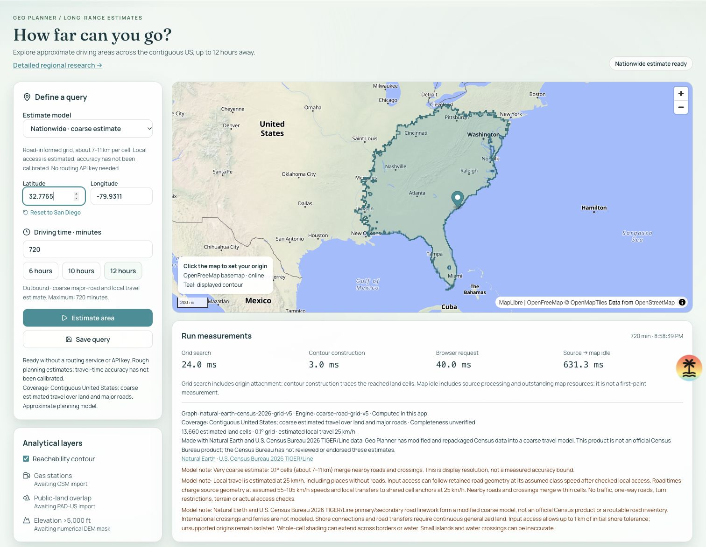

# Nationwide v5 activation and startup — October 22, 2026

**V5 is active locally; production remains verified v4 at `637746c`.** This follow-up fixes the national candidate's initialization cost without changing geometry, costs or validation. It then finalizes source notices and activates the model locally. No commit, push or cloud deployment occurred. All work after that HEAD is uncommitted, including the new source artifact.

## Exact model and source notices

Active `src/server/data/coarse-grid-v5.json` is **39,977,082 bytes**, SHA-256 `b5a53b44fa42073e22575203d4848c7c6185e8eebd4688b504cefa04ff441cd4`. [Finalization](finalization.json), [repeat](repeat-finalization.json) and independent [field/byte parity](metadata-parity.json) bind it to accepted national-v2, SHA `119a463d0a876bc83761efb235e1a8a7d9f9105c990b720c9751699c7076b95d`. Only version, source release, license, attribution and augmentation description change. All graph arrays, source locks, coordinates, anchors, masks, speeds and packed visits are identical. The finalizer pins its input and refuses existing outputs; active/local repeat bytes match exactly. Original v1–v4, pilot, national-v1 rejection and national-v2 inputs remain untouched.

The [national preparation](../coarse-national-2026-10-22/README.md) remains the source/physical recipe: 49 partitions, 289,239,748 pinned input bytes, 36,742 added links, 73 lowered existing costs, 51,159 supplemental visits / 6,220,841 points. Exact geometry/class dedup, multipart isolation and paid continuous-land transfers to the original canonical anchors apply uniformly. There are no named-place, coordinate or query-region exceptions. Only offline source selection excludes Alaska/Hawaii/territories.

API metadata, warnings and visible result text now credit Natural Earth and U.S. Census Bureau 2026 TIGER/Line, identify Geo Planner's modified/repackaged coarse model and explain that it is not an official Census product or endorsed estimate. This follows the [2026 Census source/repackaging guidance](https://www2.census.gov/geo/pdfs/maps-data/data/tiger/tgrshp2026/TGRSHP2026_TechDoc_Ch1.pdf); no source rights, topology or driving accuracy guarantee is implied. Saved old-model results display their own recorded attribution.

## Profile and generic index

[V8 samples](profile-summary.json) locate most decode work in `containsRing` and `landConnection`, repeatedly scanning 27,175 country/lake points for each supplemental transfer. [Profiled before](before.json) observes **20,827.5 ms** decode with already-parsed input; the earlier national package observed **22,201.6 ms** for its first computation after config. CPU profiling adds overhead; these are different measurement scopes.

`prepareGeography` in `src/server/coarse-geography.ts` creates a fixed 0.1° latitude-band edge index. Queries select possible edges, then use the original point-in-ring/intersection calculations. Full packed-visit, source-anchor, distance, duplicate-point and continuous-land transfer validation still runs. Country component rules, water-prefix tolerance and narrow-channel partitioning are unchanged. Prepared polygon coordinates/arrays are frozen; replacing geometry falls back to the original scan. The weakly held per-grid index stores geometry candidates only, with no point/query/decoded-visit cache. Synthetic and deterministic national parity checks compare indexed results with full scans at arbitrary segments, vertices, holes, open rings and band boundaries.

[Initial indexed observation](after-first.json) is **2,378.7 ms** decode. Other proof/parse observations are recorded with their own concurrent/process scopes rather than presented as production percentiles.

## Fresh package and retained storage

The [isolated package](package-probe.json) copied source/config plus the unchanged national-v2 candidate without env files/raw sources, using existing node_modules. It never changed the real app. After all other offline jobs finished, three sequential fresh Node processes measured their first handler computation:

| Run | First local computation after config |
| --- | ---: |
| [1](handler-1.json) | 2,460.4 ms |
| [2](handler-2.json) | 2,469.4 ms |
| [3](handler-3.json) | 2,472.5 ms |

All meet the <5-second local engineering target, with full validation and zero outbound fetches. This timing excludes earlier module/config load and does not establish Vercel cold/warm behavior. The probe is **43,782,743 bytes / 27 files**. After activation, the final [v5 handler](vercel-handler.json) is **43,779,085 bytes / 27 files**, first computation **2,509.9 ms**, next two **22.7 / 19.0 ms** in that process. Disabled detailed routing, server-only data/secrets, absence of raw/env files and no-DB history fallback all pass.

[Explicit-GC memory sweeps](memory-sweeps.json) observe **32,442,853 bytes** incremental retained decoded storage: 1,680,800 heap + 30,762,053 array buffers, with encoded input already parsed and retained separately. Fixed indexing adds about 1.42 MB versus the prior national observation. Three complete on-land anchor sweeps total **153,477 inputs**; post-GC heap growth is 114,216 / 115,472 / 115,984 bytes, buffer growth zero. Local median attachment times are 0.145 / 0.146 / 0.151 ms. Whole-process RSS, transient allocation and retained storage are distinct; no cloud peak-memory, load-capacity or latency guarantee follows.

## Preserved output and UI checks

[Physical checks](physical.json) validate all 36,815 changed link components/continuous-land transfers, 26,946 unchanged owning visits and 1,654 systematically sampled supplemental inputs against the original national-v2 build report. That report retains its original checksum binding; exact non-notice field parity transfers this proof to v5 without rewriting it.

[Candidate comparison](candidate-comparison.json) is byte-value identical to the prior national comparison; [active-v5 comparison](comparison.json) has identical costs and [path components](path-diagnostics.json) differ only in artifact path/hash. Every one of 35 saved cases is finite/reached/shaded: seven improve versus v4, 28 unchanged, none regress. Original eleven mean absolute reference difference is 22.181 → 21.944 min; broader 24-case mean is 34.234 → 31.204 min. These development references are reused, not fresh holdouts or national accuracy qualification.

[Offline national check](national.json) and [active API check](national-smoke.json) preserve all 42 national-v2 cell counts exactly, with budget monotonicity and sub-1-MB payloads. Thirty-nine gain cells versus v4; three Nantucket cases remain isolated. Cell counts do not prove road access or all-origin completeness.

[Local Chrome](browser.json) verifies arbitrary inland 6h (39.1836, -96.5717; 5,034 cells), rural 10h (38.5012, -110.7123; 8,558 cells) and coastal 12h (32.7765, -79.9311; 13,660 cells). These public validation inputs are never imported by production routing. The coastal fixture is Cloud saved, survives reload and replays to the same v5 count. Only newly created fixture history is inspected; no private cookies or bulk history export. API/schema code is unchanged; the full live DB write suite was not repeated. Console has no app errors; two pre-existing wallet-extension `window.ethereum` errors are unrelated to the app. The screenshot stops before saved-history rows.



[Checks](checks.json) record 51 server tests, fifteen Python geometry fixtures, check (139 files), app/strict diagnostic typechecks and both builds/handler passing. [Ordinary build](build.txt) and [Vercel build](build-vercel.txt) retain routine bundler warnings. No env, migration or dependency change, source download/producer, new driving reference, routing-provider call or detailed research build occurred. Local UI autosaves public test fixtures through the existing cloud-history API; no production deployment was touched.

## Reproduce deliberately

Normal app checks require only the bundled v5 file and npm dependencies. No raw source or ignored artifact is needed:

```sh
node --import tsx --test src/server/*.test.ts
npm run routing:verify:coarse
npm run build:vercel
npm run check:coarse:vercel
```

For source/notice reproduction and optional isolated package/memory checks, use [local development](../../local-development.md#nationwide-census-candidate). Original raw profiles/repeats are ignored under `data/coarse-quality/census-startup-v1/`; the isolated probe is `data/coarse-quality/census-national-v2/package-probe-startup-v1/`. Do not overwrite these outputs or rerun source producers for documentation checks. [Source hashes](sources.json) observe the implementation version; they do not freeze normal product code. [Checksums](sha256.json) seal this evidence. The next task is actual deployed v5 revision/HTTP/browser verification, followed by measured generic accuracy refinement; detailed research remains parked.
