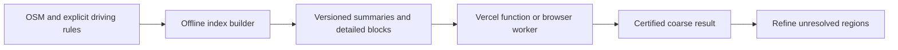

# Brainstorm: inexpensive 12-hour US driving reachability

October 16, 2026. **Status: research in progress. A [small static state reference](state-routing-reference.md) is implemented; the long-range optimizations below remain proposals, without novelty claims.** The original 10–12-hour requirement remains active. The user wants to explore building the capability ourselves before Vercel deployment. The connected openrouteservice endpoint remains a working 60-minute baseline. US focus and the single TanStack Start app on Vercel remain deployment constraints to evaluate against measurements.

The research question: **Can we produce useful, correct long-range road reachability while reading little data and doing little work per interaction?** Free-provider range limits do not establish an inherent algorithmic limit. Open-source software also leaves storage, bandwidth, preprocessing and execution costs to measure.

The user also proposed approximately 10,000 precomputed interstate points. See [anchor precomputation, storage arithmetic and independent benchmark design](anchor-precomputation-proposal.md). This adds a candidate reusable backbone and landmark bounds to the experiments. The [first offline pilot](offline-anchor-pilot.md) implements local coordinate-table precomputation/checkpoints; a separate small state-bound index is now checked on a restricted model, while national build/cache and long-range optimizations remain unimplemented.

## Established foundations

Partition-based isochrone algorithms such as isoCRP and isoPHAST preprocess shortcuts and region bounds, then inspect regions where the reachability boundary could occur. Published experiments achieve fast continental-scale network queries. Their hardware, graph model, index size and output definition matter: those timings are not our browser, cloud or polygon benchmark. [Fast Computation of Isochrones in Road Networks](https://arxiv.org/abs/1512.09090).

Turn-aware routing must preserve allowed transitions and their costs. A plain intersection graph can lose that information. [Customizable Contraction Hierarchies with Turn Costs](https://drops.dagstuhl.de/entities/document/10.4230/OASIcs.ATMOS.2020.9) is relevant prior art. [RoutingKit](https://github.com/RoutingKit/RoutingKit) supplies routing building blocks; its point-to-point examples are not a complete isochrone implementation. Import/turn support and the chosen revision need qualification.

Road membership and the shape drawn between roads are separate problems. Existing work studies compact polygons that separate reachable and unreachable network components. [Scalable Exact Visualization of Isocontours](https://drops.dagstuhl.de/entities/document/10.4230/LIPIcs.ESA.2016.7).

## Ideas worth testing

| Idea | Proposed experiment | Main uncertainty |
| --- | --- | --- |
| Skip certified regions | Use graph partitions with conservative travel-cost bounds; refine ambiguous regions | Bounds may be too loose, particularly with disconnected or directed roads |
| Files specialized for reachability | Store compact overlays, classification summaries and separately loadable detailed blocks | Whether cold queries can avoid most data without invalidating cross-region paths |
| Reuse work across time budgets | Retain travel costs or cost intervals up to a maximum budget; re-threshold on slider changes | A binary 12-hour mask alone cannot answer an exact 6-hour query |
| Reuse work across nearby origins | Recompute access to source-region gateways and combine with retained downstream summaries | Gateway count, storage, and proving coverage of all permitted paths |
| Progressive certified results | Show proven reachable/unreachable roads and refine the uncertain set | Useful error bounds and a clear geographic fill rule |
| Browser execution | Run a compact query kernel in a WebAssembly worker against versioned data | Cold downloads, memory, device variability and battery/CPU cost |
| Parallel sweeps and rendering | Evaluate GPU/SIMD after measuring contiguous graph sweeps and field rendering | Transfers and synchronization may cost more than they save |

### 1. Spend detailed work on uncertainty

Proposed output has three states: certified reachable, certified unreachable, and unresolved. For a query budget T and valid bounds L ≤ actual minimum cost ≤ U, a road state is reachable if U ≤ T and unreachable if L > T. Everything else needs refinement. This is a mathematical contract to prove for our model, not a heuristic confidence score.

Illustrative case: for a 12-hour query, if a valid path reaches a gateway in four hours and a safe bound proves every relevant state in its region is reachable from that gateway within another 20 minutes, the entire region can be certified without scanning each road at query time. If any states are disconnected from that gateway, that certificate does not apply. Region-level proofs must handle all entry paths, one-ways and restrictions; gateway membership alone is insufficient.

A large geographic outline can still contain many unresolved interior islands. Refinement cannot assume that only the outer coastline of the drawn polygon matters. Certified road membership also does not certify access to every square metre inside a displayed cell.

### 2. Design the data format around cold queries

The existing local remote-tile experiment fetched approximately 279 MB for its first 60-minute query. That used a local HTTP server and a native binding revision different from the graph builder, so it is a loading observation, not a deployment benchmark. [Recorded experiment](routing-expansion-verification.md).

Hypothesis: a contour-specific index could keep an upper-level summary available and fetch detailed road blocks only where classification or source snapping requires them. Measure bytes as carefully as CPU. Separate routing weights/connectivity from expensive polyline geometry; use packed arrays and block compression only when decoding costs justify them. All blocks must come from a coherent versioned graph, including cross-block transitions. Independently built regional tiles cannot simply be concatenated.

This combination of a small initial index, conservative answers and demand-driven detail is a candidate engineering contribution. Novelty requires a wider literature/implementation review and evidence.

### 3. Treat interaction as part of the algorithm

For a fixed origin, retained costs support multiple thresholds. If we retain only intervals, a changed budget may require additional refinement. The representation should expose that work rather than silently reusing a coarse binary mask. A common underlying cost representation can also help us maintain nested results across budgets; output simplification needs its own consistency tests.

For an origin moving within one small region, a research candidate is gateway reuse. If access costs to gateways are a_i, downstream costs can be combined as the minimum of a_i plus the relevant gateway-to-target cost. Exactness requires all relevant exit states and paths, plus separate handling of destinations within the source region. Caching every gateway's nationwide field could erase the benefit through quadratic storage; begin with a bounded source-region experiment. Linear interpolation between nearby origins is only an approximation and can fail across divided roads, rivers and prohibited turns.

For display, test a travel-cost texture/adaptive mask that MapLibre can threshold, followed by polygon export when requested. GPU thresholding of an available field is a different task from finding permitted paths. A future clicked road/entrance query could receive an exact graph answer while a large overview remains generalized. POI/database layers remain outside the first routing experiment.

## Deployment hypothesis

Keep one fullstack TanStack Start application on Vercel. Build indexes offline; host immutable summaries and detailed blocks in file/object storage. Measure a query kernel first locally, then in a Vercel function and/or a browser WebAssembly worker. No additional persistent routing service is assumed approved by this design. If neither execution location meets memory, cold-transfer and latency requirements, revisit that constraint with concrete evidence. Current [Vercel limits](https://vercel.com/docs/functions/limitations) must be checked against the selected runtime/plan; warm-instance reuse is a benefit, not durable storage.

## First experiment and decision gates

1. Specify static minimum modeled driving time, directed access/turn rules and partial-road snapping. Keep engine preference penalties distinct from elapsed-time semantics. Define the policy for routes that cross Canada/Mexico; US product scope alone does not define it.
2. The [initial bounded-Dijkstra/Bellman–Ford and per-state landmark experiment](state-routing-reference.md) is complete on a simplified downtown model. The [cell-summary comparison](cell-routing-experiment.md) verifies grouping/selective reads but finds no exact-query speedup. The [compact native baseline](native-routing-baseline.md) matches that graph with faster direct search and separate setup/encoding/transfer measurements. A separate [v2 model](maneuver-routing-model.md) now qualifies prohibited via-way history and partial destinations. The [regional capacity probe](regional-routing-capacity.md) now verifies a 387,236-state corridor and approximately 21 ms warm search loops, but finds border-access exclusions and a wider-import OOM. Next address those issues before wider coverage. Existing Valhalla contours are an operational comparison, not an exact oracle: their known route/polygon and nesting disagreements remain unresolved.
3. Begin with existing bounded data at meaningful short budgets. Before a 12-hour run, assess source/download, intermediate disk and build RAM for a sufficiently broad western-US/multicountry extract. The current California/Baja graph is too restricted to validate a complete 12-hour result. Do not relabel a clipped 720-minute response as successful coverage.
4. Measure cold bytes read/downloaded, peak memory, preprocessing/index size, states/regions examined, graph computation, representation, serialization and browser display separately. HTTP round trip remains an end-to-end measure. Compare 2/6/10/12-hour budgets on urban, rural, mountain, coastal and border-adjacent origins once coverage supports them.
5. Check all graph-state memberships against the reference for initial bounded instances; test threshold nesting and false positives/negatives. Record remaining geographic fill error independently. Optimize only after identifying the dominant cost.

Choose the first optimization by evidence: region classification when expansion dominates, compact/demand-loaded blocks when I/O dominates, or representation changes when geometry/rendering dominates. Candidate performance goals can then be set against named hardware and cold/warm conditions. No runtime, memory, download-size or commercial novelty guarantee has been established.

The immediate recommendation is **a correct long-range reference plus one measurable experiment in region classification/data access**. Preserve the hosted baseline and defer cloud rollout until the required range has a credible implementation path. Worldwide coverage, elevation, PostGIS layers and road-distance/combined-budget semantics remain deferred.
