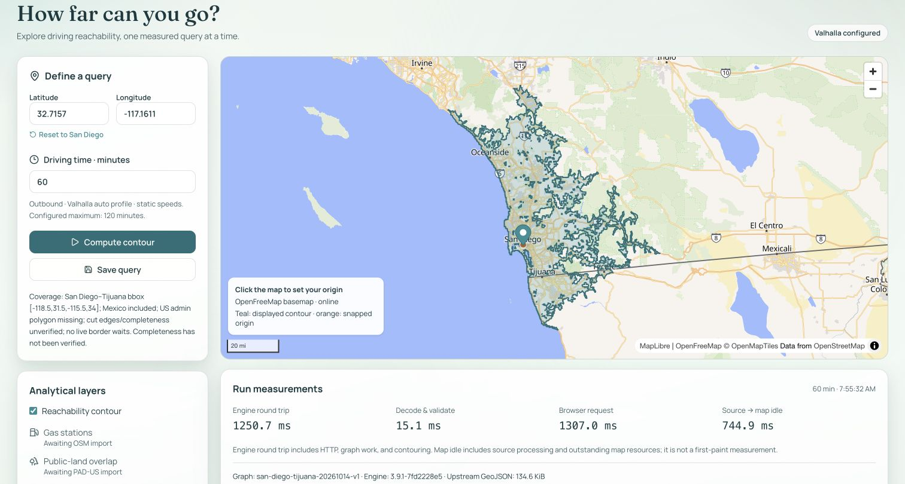

# Regional routing verification — 2026-10-16

The default 60-minute San Diego query works through a real local Valhalla graph, the server adapter, and MapLibre. It is an **operational baseline with unresolved correctness findings**, not a validated minimum-time reachability model. [Reproduce it](regional-routing.md) before extending the routing semantics.

## Identity and resource measurements

- Engine: `3.9.1-7fd2228e5`, full revision `7fd2228e5863b442bc1ac8d25eece6415dd91bff`; immutable multiarchitecture image digest in [`routing/manifest.json`](../routing/manifest.json). Tested on Linux ARM64 in Docker Desktop, Apple M4 / 10 cores / 16 GiB host RAM; Docker VM 7.65 GiB.
- Both OSM inputs: `2026-10-14T20:21:12Z`; source SHA-256 and published MD5 in the manifest. Downloaded 1,318,456,511 bytes after assessing remote `Content-Length`, local disk (271 GiB free), RAM, and Docker capacity. No analytical datasets were downloaded.
- Build settings: requested bbox `[-118.5,31.5,-115.5,34]`, `complete_ways`, merged sources, full-source admin build, two workers, 4 GiB container cap, standard hierarchy/shortcut/restriction/validation pipeline. The complete engine-generated [configuration](evidence/routing-2026-10-16/valhalla.json) is retained.
- Successful build: **234.02 seconds** wall time for checksum verification + merge + clip + admin + graph + packaging; graph pipeline itself logs **77 seconds**. GNU time's largest child-process RSS is **3,889,428 KiB (3.71 GiB)**, not total container/VM peak. No swap was reported by GNU time. Download/image pull and the earlier failed attempt are excluded.
- Clipped PBF: **362,411,877 bytes**; admin DB: **19,382,272 bytes**; archive: **508,610,560 bytes (485.05 MiB), 126 tiles**. Unpacked tiles occupy about 510 MiB; original data directory occupied 3.8 GiB including original/merged/clipped PBFs and both graph forms. Retain 10 GiB free capacity for one build plus images/intermediates. This is not a measured minimum.
- After restart and the production query, a single `docker stats --no-stream` observation reported **426.8 MiB / 2 GiB** for the service. Docker's reported working usage excludes reclaimable cache; this is a snapshot, not measured service peak RAM.
- An initial recipe attempt failed after preparation because it addressed `mjolnir.logging`, which this engine stores at the config root. That line was removed; the successful full build exited 0. Failure logs/resources remain in ignored local data. Warnings from the successful build are retained [verbatim without terminal color codes](evidence/routing-2026-10-16/build-warnings.txt).

[Artifact sizes/hashes and build identity](evidence/routing-2026-10-16/build-complete.json), [GNU time output](evidence/routing-2026-10-16/build-resources.txt). Tar bytes can differ on rebuild because of build timestamps; byte identity is not claimed.

The **final manifest-driven recipe was built a second time in an isolated directory**, reusing read-only source files: **231.45 seconds**, largest process RSS **3,879,968 KiB**, exit 0. Its clipped PBF and generated config hashes matched the first build; admin DB and tile archive hashes differed. Serving it temporarily on loopback port 8003 returned a default 60-minute FeatureCollection exactly equal to the first build (all geometry, properties, and location features). This validates one repeatable output, not every route or binary determinism. The temporary container was removed. See [exact rebuild command](evidence/routing-2026-10-16/rebuild-command.txt), [second provenance](evidence/routing-2026-10-16/rebuild-complete.json), [resources](evidence/routing-2026-10-16/rebuild-resources.txt), and [comparison record](evidence/routing-2026-10-16/rebuild-comparison.json). Normal `routing:down` / `routing:up` also restored a healthy service without rebuilding.

## Live adapter protocol and measurements

Command, with the service and development app running:

```bash
npm run routing:verify > data/valhalla/verification-report.json
```

The retained [raw measurement summary](evidence/routing-2026-10-16/summary.json) contains 24 sequential adapter calls: one first sample per budget and five subsequent samples. The final retained run had no overlapping browser query or graph build. OS page cache was not flushed, and prior runs had warmed the service. The first sample is **not a cold-cache benchmark**. p50/p95 below use nearest rank over only five subsequent samples; p95 is simply the largest of those five and is not a stable tail estimate. There was no load/concurrency benchmark.

| Minutes | First engine HTTP round trip (ms) | Subsequent p50 / p95 (ms) | Decode/validate p50 (ms) | Upstream bytes |
| --- | ---: | ---: | ---: | ---: |
| 15 | 430.8 | 320.7 / 378.8 | 3.1 | 60,120 |
| 30 | 462.6 | 452.5 / 464.3 | 4.4 | 81,743 |
| 60 | 616.7 | 618.6 / 629.1 | 6.0 | 137,822 |
| 120 | 1,593.9 | 1,479.5 / 1,526.5 | 12.4 | 361,439 |

`engineRoundTripMs` measures upstream fetch through body read, including HTTP, snapping/search, contour construction, and engine serialization. It is **not isolated graph-search time**. The summary also retains server-total and independent Node HTTP/body-read timings. Vite/Node overhead and JSON validation are separate from engine work. Browser request and source-to-map-idle are different measurements; neither is an isolated engine measurement or first paint. Native stage timing was not instrumented.

## Snapping, routes, warnings, and nesting

Input origin: **lat 32.7157, lon −117.1611**. All four contour responses snap to **lat 32.715695, lon −117.161085**, approximately **1.5 m** away. The real engine returns a Polygon/MultiPolygon, a snapped MultiPoint, and an input Point. The missing Point variant initially caused HTTP 502 from the adapter; the schema and map-bounds iteration now accept it, with regression coverage based on the [captured real 15-minute response](../src/server/fixtures/README.md). Responses containing only locations still fail validation.

The verifier calls `/route` using the same auto profile/speed sources and no date/time. It decodes polyline6 endpoints and checks those snapped endpoints against each polygon including holes. Destination snapping varies; approximate distances below are from supplied coordinates to the returned route endpoint. The test is against the **same engine**, so agreement is not an independent optimality or source-data validation.

| Destination sample | Modeled route minutes | Destination snap (m) | First tested contour containing endpoint |
| --- | ---: | ---: | --- |
| Balboa Park | 3.92 | 38.0 | 15 |
| La Jolla | 16.85 | 2.9 | 30 |
| Escondido | 30.44 | 4.0 | 60 |
| Carlsbad | 36.35 | 4.2 | 60 |
| Julian | 67.15 | 8.5 | 120 |
| Temecula | 55.13 | 5.7 | 60 |
| Tijuana | 32.51 | 4.6 | 60 |
| Rosarito | **66.27** | 24.6 | **60 — disagreement** |
| Ensenada | 109.74 | 41.4 | 120 |
| El Centro | 104.70 | 24.7 | 120 |

For 39 of the 40 destination/budget comparisons, default-route elapsed-time membership and polygon membership agree. **Rosarito is an unresolved counterexample:** its default route uses Otay and takes 66.27 modeled minutes while its snapped endpoint is inside the 60-minute polygon. The saved [route request/response](evidence/routing-2026-10-16/route-rosarito.json) and [60-minute adapter response](evidence/routing-2026-10-16/default-60.json) allow replay. A diagnostic forced waypoint near San Ysidro produced a longer 114.75-minute route and did not resolve the discrepancy; it remains in ignored local verification data. Profile preferences, location direction/snap, contour construction, and expansion differences have not been isolated. Do not label this as a known 100 m simplification error or infer a minimum-time route from the default route alone.

Downtown westbound and eastbound diagnostics show **42.083 seconds / 586 m** versus **7.350 seconds / 114 m**. The westbound response includes a left U-turn at West Broadway, while the reverse travels directly east. This is evidence of directional snapping/divided-road behavior, not proof that a named OSM one-way or turn restriction was imported correctly. The [responses](evidence/routing-2026-10-16/route-downtown-west.json) and [reverse](evidence/routing-2026-10-16/route-downtown-east.json) are retained. Graph build logs report complex restrictions added at each hierarchy, but no source-level prohibited-turn case or disconnected-road origin was independently verified.

The [outbound Tijuana route](evidence/routing-2026-10-16/route-tijuana.json) is 32.51 minutes; [return](evidence/routing-2026-10-16/route-tijuana-return.json) is 34.01 minutes. Both use San Ysidro approaches with a maneuver of about 600 seconds at the crossing. This is consistent with the profile's default crossing cost, but **US/California country/state polygons were skipped** because source relation members are missing; only Mexico's country polygon is in the admin DB. Correct country override/access and border-edge attribution remain unverified. Fixed modeled crossing time does not represent live border queues or eligibility.

The engine returned **no contour or route warnings** in the retained normal samples. Build warnings include skipped admin polygons, regional `admin_access` insert errors, topology repair warnings, missing timezone/elevation directories, and one node exceeding shortcut-edge capacity. Engine silence does not establish completeness or correctness.

Coarse polygon nesting was sampled every 0.025° across the requested bbox (roughly 2–3 km spacing):

| Contour pair | Lower-contour sample members | Missing from upper |
| --- | ---: | ---: |
| 15 → 30 | 68 | 0 |
| 30 → 60 | 217 | 0 |
| 60 → 120 | 763 | **4** |

The four missing longitude/latitude samples are approximately `(-116.925,32.625)`, `(-117.150,32.675)`, `(-116.700,32.825)`, `(-116.750,33.000)`. These are geographic polygon checks, not exact road-edge membership. The larger output's holes/generalization/grid behavior require investigation before claiming nested exact sets. It was not silently unioned with smaller contours. The 15/30/60/120 outputs have 1/3/3/1 polygon components and 259/184/242/652 holes respectively, with denoise 0; disconnected-looking filled components were retained, not independently verified for network connectivity.

The 60-minute contour bounds are `[-117.654260,32.239933,-116.259662,33.592574]`, inside the requested cut. The 120-minute bounds are `[-118.438753,31.738717,-115.268030,34.030399]`, reaching beyond its north/east edges because complete ways and contour filling can extend beyond the extraction rectangle. This is strong boundary-truncation risk, not evidence of complete coverage beyond the bbox. There is no automated boundary detector; `coverageVerified` remains false.

## Browser, checks, and handoff

Browser verification used the connected Chrome browser because the Superset CLI was unavailable. The dev app completed 15/30/60/120-minute queries through the controls, cleared stale measurements when the budget changed, displayed version/coverage labels, and saved real runs locally. No application console errors were observed; an unrelated wallet extension reports `window.ethereum` errors. Vite's forwarded browser log also records OpenFreeMap style-filter warnings about null values where numbers are expected (boundary/highway-shield layers fall back to false); the basemap still renders. These basemap-style warnings were not changed in this routing session.

Production-preview command after `npm run build`:

```bash
node --env-file=data/valhalla/app.env node_modules/vite/bin/vite.js preview --port 4173
# To use this preview instead of the development app for a new live report:
GEO_PLANNER_URL=http://localhost:4173 npm run routing:verify
```

The production default query was visually verified after restarting the routing process: **1,250.7 ms engine HTTP round trip, 15.1 ms server decode/validation, 1,307.0 ms browser request, 744.9 ms source-to-map-idle**, 134.6 KiB upstream GeoJSON. This is one process-first request with an already warm OS cache, not a cold or warm percentile. The online basemap, contour across San Diego/Tijuana, attribution, metadata, and coverage caveat render. Hiding/restoring the contour works. At this zoom the input marker can cover the snapped location only 1.5 m away; the numeric snap was verified from the real response. No engine warnings or application console errors appeared; wallet-extension errors are unrelated. [Visible page text](evidence/routing-2026-10-16/browser-default-60.txt) and the screenshot retain the result.



Required checks pass: seven tests, `npm run check` (one existing DB non-null assertion warning), `npm run typecheck`, and `npm run build` (existing MapLibre chunk-size / upstream TanStack directive warnings). No deployment or DB migration was performed. No secrets were committed; Git still has no commits, and existing untracked work/environment values were preserved.

Session handoff: Docker Desktop and Valhalla remain running at `http://127.0.0.1:8002`; the verified production preview is at `http://localhost:4173`. The temporary development server and rebuild-check service were stopped. The isolated second graph remains under ignored `data/valhalla-rebuild/` as reproduction evidence; it is not the active service graph. Stop Valhalla with `npm run routing:down`. Existing `.env.local` was unchanged, and the generated `data/valhalla/app.env` contains only local routing settings.

**Next task:** acquire a reproducible complete admin source, rebuild with a new graph identity, and revalidate US/MX codes and border costs at San Ysidro and Otay in both directions. Then isolate the Rosarito and nesting discrepancies and verify concrete source-level one-way/turn/disconnected cases. Keep PostGIS, elevation, distance semantics, caching, and advanced routing research deferred. See [next steps](next-steps.md).
